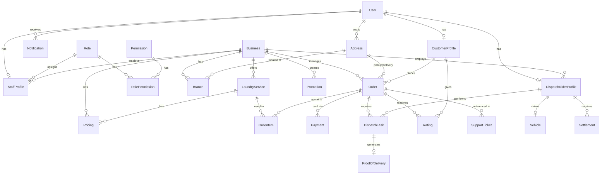

# Entity-Relationship Diagram (Phase 2)

This diagram documents the core 20-entity PostgreSQL schema designed for the Laundry Management Platform.

## Key Polymorphism Approach

- **Users** represent the identity base (`User` table with credentials and `userType`).
- Roles are segregated into specific profile tables: `CustomerProfile`, `StaffProfile`, and `DispatchRiderProfile`.
- A Business Owner is a `User` linked directly to a `Business` entity.

## RBAC Design

- Custom roles are assigned via `Role` and checked against `RolePermission`.
- A rider is inherently a `DispatchRiderProfile`, whereas a backend operator is a `StaffProfile` with an attached `Role`.
