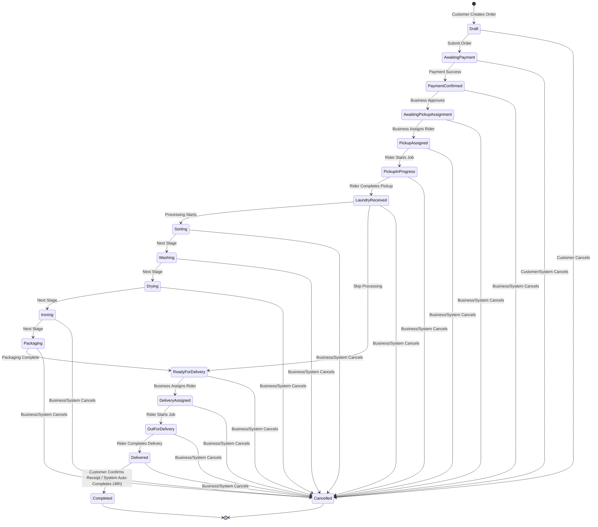

# Order Status Flow

The following state machine diagram illustrates the valid order statuses and transitions within the Savi application. This workflow engine is governed by the `OrderWorkflowService`.

## Implementation Details

- **Transitions Engine**: `OrderWorkflowService` enforces transitions.
- **Rules Mapping**: Located in `transitions` array in `OrderWorkflowService`.
- **Side Effects**: Side effects such as auditing and timeline events are built directly into the workflow transition service.
- **Actor Enforcement**: The transition rules are bound by `ActorType` (`Customer`, `BusinessOwner`, `Staff`, `DispatchRider`, `System`).
- **Legacy Compatibility**: Transitions persist to `OrderStatusHistory` table (new) as well as the `OrderTimeline` table (legacy).
